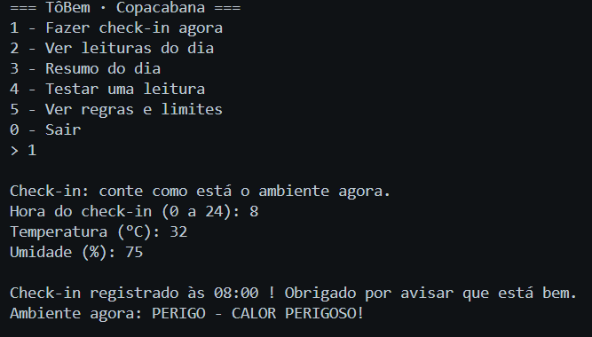
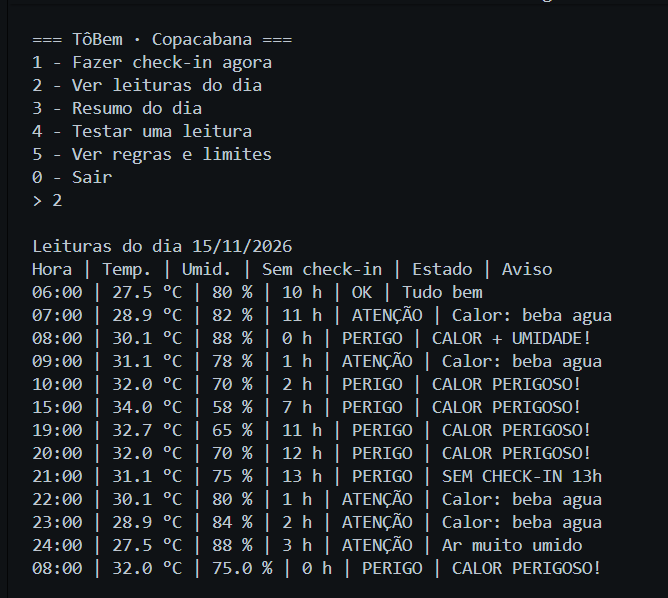
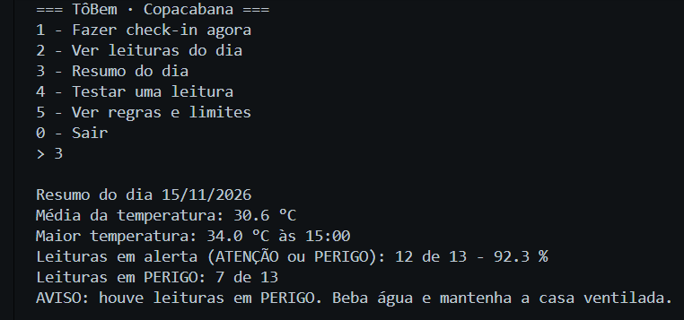
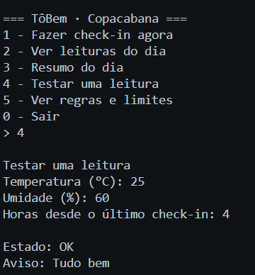
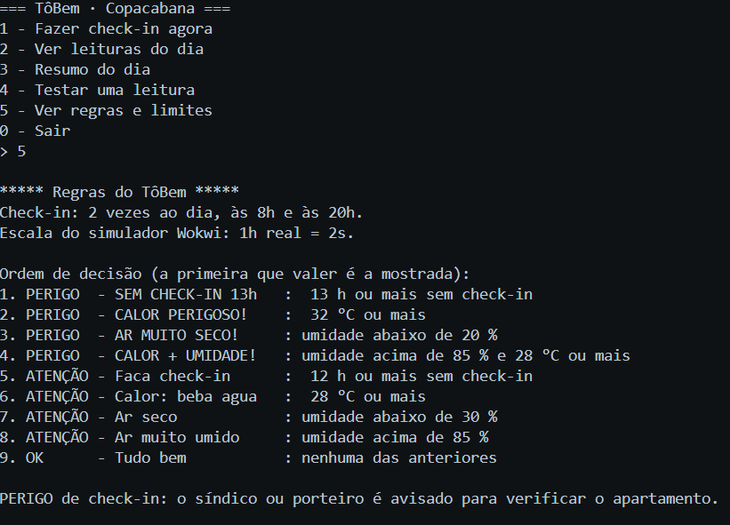

# 🧠 TôBem · O cérebro em Python

> Programa em Python que olha os dados do apartamento de um idoso que mora sozinho em Copacabana e decide qual aviso mostrar: **OK**, **ATENÇÃO** ou **PERIGO**.

**Disciplina:** Computational Thinking with Python · Prof. Cainã Pinel
**FIAP · Global Solution 2026.2 · CitizenTech · Engenharia de Software 1º ano · Rio de Janeiro**

## 👥 Integrantes

| Nome            | RM     |
| --------------- | ------ |
| Gabriel Almeida | 575525 |
| Anne Bortoli    | 574750 |

---

## 👵 O problema

Idosos que moram sozinhos podem sofrer uma queda ou um mal-estar dentro de casa e ficar horas sem socorro, porque ninguém percebe a tempo. No caso real que inspirou o projeto, uma moradora do nosso prédio só foi encontrada cerca de **24 horas** depois de cair.

O **TôBem** não tenta detectar a queda. Ele observa a **falta do check-in**: o idoso confirma duas vezes por dia que está bem, e se isso não acontece, o porteiro ou o síndico é avisado. O programa também acompanha a **temperatura** e a **umidade**, porque o calor do Rio é um risco real para quem tem mais de 60 anos.

## ⚙️ O que o programa faz

- Guarda uma lista com **12 registros simulados** de um dia de calor em um apartamento.
- **Classifica** cada registro com `if/elif/else`, usando as mesmas regras do dispositivo.
- Calcula o **resumo do dia**: média e maior temperatura, e percentual de leituras em alerta.
- Permite **fazer check-in** e **testar uma leitura** digitando os valores.
- **Não quebra** com entrada inválida.

---

## 📁 Estrutura da pasta

```
python/
├── main.py
├── README.md
├── prompts.md
└── assets/
    └── print-execucao.png
```

## ▶️ Como rodar

1. Instale o **Python 3** ([python.org](https://www.python.org/downloads/)). Não é preciso instalar nenhuma biblioteca.
2. Abra o terminal na pasta `python/`.
3. Rode:

```bash
python main.py
```

> 💡 No Mac ou no Linux, pode ser preciso usar `python3 main.py`.

## 🧭 Menu

| Opção                        | O que faz                                                                                        | Para quem                   |
| ---------------------------- | ------------------------------------------------------------------------------------------------ | --------------------------- |
| **1** · Fazer check-in agora | Pede hora, temperatura e umidade, registra o check-in no histórico e mostra o estado do ambiente | Idoso                       |
| **2** · Ver leituras do dia  | Lista os registros, cada um com estado e aviso                                                   | Porteiro, síndico, familiar |
| **3** · Resumo do dia        | Média e maior temperatura, % de leituras em alerta e em perigo                                   | Porteiro, síndico, familiar |
| **4** · Testar uma leitura   | Classifica uma temperatura, umidade e horas digitadas                                            | Demonstração                |
| **5** · Ver regras e limites | Mostra a ordem de decisão e os limites usados                                                    | Todos                       |
| **0** · Sair                 | Encerra o programa                                                                               | Todos                       |

---

## 🚦 Regras de decisão

O programa testa as regras **de cima para baixo** e mostra a primeira que for verdadeira. É a mesma ordem do código do dispositivo (Edge Computing).

| Ordem | Condição                                                 | Estado     | Aviso            |
| ----- | -------------------------------------------------------- | ---------- | ---------------- |
| 1     | 13 h ou mais sem check-in                                | 🔴 PERIGO  | SEM CHECK-IN 13h |
| 2     | Temperatura de 32 °C ou mais                             | 🔴 PERIGO  | CALOR PERIGOSO!  |
| 3     | Umidade abaixo de 20 %                                   | 🔴 PERIGO  | AR MUITO SECO!   |
| 4     | Umidade acima de 85 % **e** temperatura de 28 °C ou mais | 🔴 PERIGO  | CALOR + UMIDADE! |
| 5     | 12 h ou mais sem check-in                                | 🟡 ATENÇÃO | Faca check-in    |
| 6     | Temperatura de 28 °C ou mais                             | 🟡 ATENÇÃO | Calor: beba agua |
| 7     | Umidade abaixo de 30 %                                   | 🟡 ATENÇÃO | Ar seco          |
| 8     | Umidade acima de 85 %                                    | 🟡 ATENÇÃO | Ar muito umido   |
| 9     | Nenhuma das anteriores                                   | 🟢 OK      | Tudo bem         |

- ⏰ **Check-in:** 2 vezes ao dia, às 8h e às 20h. Com 12 h sem check-in, o idoso recebe um lembrete. Com 13 h (1 h de tolerância), o porteiro ou síndico é avisado.
- 🔤 **Avisos sem acento:** são os mesmos textos do LCD do dispositivo, que não mostra acentos.

## 📊 Dados simulados

Os 12 registros representam um dia de calor em um apartamento de Copacabana. Cada registro é uma lista:

```python
["06:00", 27.5, 80, 10]   # [hora, temperatura °C, umidade %, horas desde o último check-in]
```

As temperaturas seguem a parábola do relatório de Matemática, **T(t) = −0,08·(t − 15)² + 34**, com pico de 34 °C às 15h. Os registros também contam uma pequena história:

- ✅ **08:00:** check-in da manhã feito.
- ⏳ **20:00:** chega a hora do check-in da noite, mas ele não é feito.
- 🚨 **21:00:** 13 h sem check-in, e o porteiro é avisado.
- 🙋 **22:00:** o porteiro verificou e a idosa fez o check-in.

> ⚠️ Todos os dados são simulados. O programa não usa dados reais de nenhuma pessoa.

---

## 🖼️ Print da execução







<details>
<summary>📄 Saída de exemplo do resumo (opção 3)</summary>

```
Resumo do dia 15/11/2026
Média da temperatura: 30.5 °C
Maior temperatura: 34.0 °C às 15:00
Leituras em alerta (ATENÇÃO ou PERIGO): 11 de 12 - 91.7 %
Leituras em PERIGO: 6 de 12
AVISO: houve leituras em PERIGO. Beba água e mantenha a casa ventilada.
```

</details>

## 🛡️ Entrada inválida

O programa não quebra com nenhuma digitação:

- **Menu:** a opção é comparada como texto. Qualquer coisa diferente de 0 a 5 mostra "Opção inválida" e o menu volta.
- **Números:** antes de converter com `float()`, a função `eh_numero()` confere se o texto é mesmo um número. Se não for, a pergunta se repete.
- **Vírgula:** `25,5` e `25.5` são aceitos.
- **Faixas:** valores sem sentido são recusados, como umidade acima de 100 % ou hora acima de 24.

## 🔗 Integração com as outras disciplinas

| Disciplina              | Como se conecta                                                                                                                                                                                                                               |
| ----------------------- | --------------------------------------------------------------------------------------------------------------------------------------------------------------------------------------------------------------------------------------------- |
| 📟 **Edge Computing**   | Os limites têm os **mesmos nomes e valores** das constantes do código do Arduino Uno (`sensor/sketch-final.ino`), e a ordem de decisão é a mesma. No simulador, 1 h real = 2 s. [Ver no Wokwi](https://wokwi.com/projects/479775938984317953) |
| 📐 **Matemática**       | As temperaturas dos registros saem da parábola do relatório técnico.                                                                                                                                                                          |
| 🌐 **Web Development**  | A função `classificar()` será reescrita em JavaScript com as mesmas regras. conferir.                                                                                                                                                         |
| 🎨 **Front-end Design** | Os avisos impressos são os mesmos textos da página.                                                                                                                                                                                           |
| 🧩 **Experiência**      | As opções do menu saem da jornada do idoso (check-in) e do porteiro (leituras e resumo).                                                                                                                                                      |
| 🎬 **Pitch**            | O programa rodando entra no vídeo como prova de que a lógica funciona.                                                                                                                                                                        |

## 🚧 Limitações e melhorias futuras

- 💾 Os check-ins ficam guardados só **enquanto o programa está aberto**. Ao fechar, a lista volta aos 12 registros simulados. Uma melhoria futura seria gravar em arquivo ou banco de dados.
- 🕐 O check-in guarda só a **hora cheia** (8.7 vira 08:00).
- 🌡️ Temperaturas negativas não são aceitas, o que não é um problema dentro de casa no Rio.
- 🔔 O aviso ao porteiro é uma mensagem na tela. Em uma versão real, seria uma notificação no celular.

## 🤖 Uso de IA

Usamos o Claude (Anthropic) como apoio para planejar o programa, revisar a lógica e sugerir testes. Todo o código foi digitado, testado e entendido pela equipe, passo a passo, com um commit por etapa. Os prompts estão em [`prompts.md`](prompts.md).
